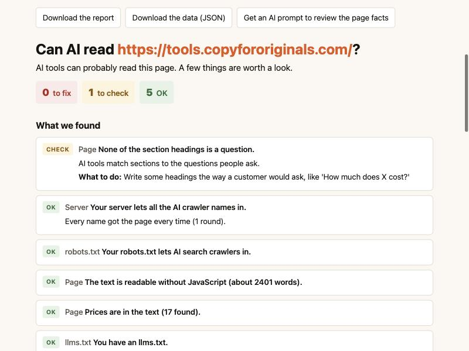

# Can AI read my site?

**A free tool that checks whether ChatGPT, Claude and Perplexity can read the facts on your web pages, and whether your server lets their crawlers in.**

You type in a web address. A minute later you get a short report with three kinds of results: **Fix**, **Check** and **OK**. Each one says what to do next, in plain words.

It runs on your own computer, or your IT team can run it on a company server for everyone. It is free and open source (MIT license). Made by [Copy for Originals](https://tools.copyfororiginals.com/can-ai-read-my-site/).



## What it checks

### 1. Can an AI find the facts on your page?

Most AI crawlers don't run JavaScript. They read the raw page and pick out facts they can quote. So the tool reads your page the same way and looks for the things AI answers are built from:

- **Words a crawler can see.** If most of your text is added by JavaScript, the crawler may see almost nothing.
- **Prices.** Pages with clear prices get picked more often. The tool also flags prices that only live in hidden code (structured data). In one test, no AI tool found a price that was only there.
- **Dates.** AI tools favor text that looks recent. Is there a visible "Last updated" date?
- **Hidden text.** Answers inside closed tabs or accordions may get thrown away.
- **Headings.** Are any of your section headings written as the questions customers ask?

It can also give you a ready-made prompt. Paste it into ChatGPT, Claude or Gemini, and it will list which facts your page is missing: price, what's included, who it's for, how long it takes, and what can go wrong.

### 2. Does your server let AI crawlers in?

Many free tools can tell you this, and some are very good (see the list below). This tool uses the method from our study of 100 law firm websites:

- It asks for your page as a normal browser, as nine AI crawlers, and as Google and Bing.
- It does this **several times, a few seconds apart, in a random order**.
- Then it compares the answers.

Why bother? In [our study](https://tools.copyfororiginals.com/law-firm-websites-ai-crawlers-study/), 13 of 78 sites turned away an AI crawler's name every time. **12 of those 13 had nothing in robots.txt that showed it.** The block came from a firewall or a security plugin, and the owner usually didn't know. And 11 of the 13 let Google's and Bing's names in.

Comparing against Google and Bing tells you what kind of block it is:

| What you see | What it probably means |
| --- | --- |
| AI names turned away, Google and Bing let in | A rule aimed at AI crawlers. Ask your host or IT team about it. |
| AI names and Google or Bing turned away | Your server may check whether a visitor is real. The real crawler may get in. Check your server logs. |
| Sometimes yes, sometimes no | Often a rate limit. Run the check again later. |

### 3. What does your robots.txt say?

It reads your robots.txt the way the official standard (RFC 9309) says crawlers should. Then it shows which AI crawlers are allowed on the page you checked, and which rule decided it.

It keeps two kinds of AI crawlers apart:

- **Search crawlers** like OAI-SearchBot and Claude-SearchBot. If you block these, you can't appear in that AI's answers.
- **Training crawlers** like GPTBot and ClaudeBot. Blocking these keeps your pages out of AI training. It does **not** remove you from AI answers.

## Other free checkers

If you only want to know whether AI crawlers can reach your home page, these free tools work well, and you don't need to install anything:

- [365i AI Crawler Checker](https://www.365i.co.uk/tools/ai-bot-checker/): live requests as 12 AI crawlers, plus robots.txt. No sign-up.
- [Zeevron AI Crawler Checker](https://www.zeevron.com/tools/ai-crawler-checker): live requests as a browser and as each AI crawler. No sign-up.
- [RankX AI Crawler Access Checker](https://rankxai.com/tools/ai-crawler-access-checker): live requests as 24 AI crawlers, more names than this tool tests. No account.
- [TryGeoSuite ai-crawler-bots](https://github.com/TryGeoSuite/ai-crawler-bots): an open-source command line and GitHub Action.

Use this tool when you also want to know whether the AI can **find the facts** on your page, when you want the Google and Bing comparison, or when you want to run it inside your company.

## How to run it

You need Python 3.9 or newer. Macs come with it. Nothing else to install.

### Option A: the web page on your own computer (easiest)

1. Download this project: click the green **Code** button above, then **Download ZIP**. Unzip it.
2. Open **Terminal** and go to the unzipped folder. (Type `cd `, drag the folder into the Terminal window, and press Enter.)
3. Run this:

   ```bash
   python3 -m can_ai_read serve --open
   ```

4. Your browser opens. Type in your web address and click **Check now**.

Press `Ctrl+C` in Terminal to stop it.

### Option B: the command line

```bash
python3 -m can_ai_read https://yoursite.com/
```

Useful options:

| Option | What it does |
| --- | --- |
| `--quick` | One round instead of three. Faster, less sure. |
| `--runs 5` | Five rounds. Slower, more sure. |
| `--html report.html` | Saves a report you can open in a browser or send to someone. |
| `--prompt prompt.txt` | Saves an AI prompt that reviews your page's facts. |
| `--json` | Prints the results as data, for scripts. |

You can check several pages at once: `python3 -m can_ai_read https://yoursite.com/ https://yoursite.com/pricing`

To install it as a command called `can-ai-read`:

```bash
python3 -m pip install git+https://github.com/jbastide/can-ai-read-my-site
```

### Option C: on a company server, for the whole team

Your IT team can run the web page in a container. From a copy of this project:

```bash
git clone https://github.com/jbastide/can-ai-read-my-site.git
cd can-ai-read-my-site
docker compose up -d --build
```

Everything IT needs to know is in **[DEPLOY.md](DEPLOY.md)**: settings, security, sign-in and network rules.

## What it can't tell you

- **It is not the real crawler.** The requests come from your computer or server, not from OpenAI, Anthropic or Perplexity. A site can treat the real crawlers differently. Only your server logs show what the real crawlers got.
- **It checks one page at a time.** Other pages on your site may behave differently. Check your most important pages: home, pricing and your main service pages.
- **It can't tell you if an AI will recommend you.** Being readable is the first step, not a guarantee. What else decides it is in [our guide to AI recommendations](https://tools.copyfororiginals.com/what-decides-ai-recommendations/).
- **Bot protection may block the tool itself.** If even the normal browser test is turned away, the report says so. Try from another network.

## Privacy

- The tool only contacts the website you ask it to check.
- It doesn't track you or send data anywhere else.
- The web page keeps results in memory for one hour, then forgets them. Nothing is saved to disk.

## Please be polite

Only check sites you own or have permission to test. Each check sends about 35 requests to the site, spread over a minute or so.

## Questions or problems

Open an issue on GitHub. For security problems, see [SECURITY.md](SECURITY.md).

## License

MIT. Use it, change it, share it.
